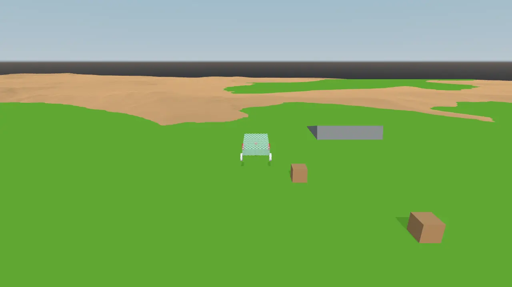

# Raycaster vehicle

A raycast vehicle for Qt Quick 3D Physics, written entirely in QML. Each wheel
is a `Raycaster` pointing down from the chassis. The distance to the ground
drives a spring-damper suspension. Tire friction and engine force are applied at
the same point.



## Requirements

Use Qt from the dev branch until 6.13 is branched, then use the 6.13 branch.
The build needs Qt Quick 3D and Qt Quick 3D Physics from the same branch. The
required `DynamicRigidBody` velocity properties and `Raycaster` are included in
Qt Quick 3D Physics dev.

If Qt Quick 3D Physics is not already installed in your Qt prefix, clone its
source and check out the branch matching the rest of your Qt build:

```bash
git clone https://code.qt.io/qt/qtquick3dphysics.git
cd qtquick3dphysics
git switch dev  # or 6.13 once that branch exists
```

Build Qt Quick 3D Physics and install it into your Qt prefix:

```bash
mkdir build && cd build
/path/to/Qt/6.13/gcc_64/bin/qt-configure-module ..
cmake --build . --parallel
cmake --install .
```

Qt Quick 3D Physics uses internal Qt Quick 3D API that changed after 6.12, so
the Qt Quick 3D in that prefix must come from the same branch.

## Build and run

```bash
cmake -S . -B build -DCMAKE_PREFIX_PATH=/path/to/Qt/6.13/gcc_64
cmake --build build
./build/raycastvehicle
```

| Key   | Action                      |
|-------|-----------------------------|
| W     | Accelerate                  |
| S     | Brake, then reverse         |
| A / D | Steer                       |
| Space | Brake                       |
| R     | Respawn                     |

## How it works

| File           | Contents                                          |
|----------------|---------------------------------------------------|
| `Main.qml`     | Window, keyboard input, follow camera             |
| `Hud.qml`      | Key hints that light up while a key is held       |
| `Vehicle.qml`  | Chassis body, automatic gearbox, steering         |
| `Wheel.qml`    | Suspension ray, spring, damper and tire forces    |
| `Terrain.qml`  | Height field and obstacles                        |

Every wheel owns a ray cast in its local space. The ray ignores the chassis it
belongs to:

```qml
Raycaster {
    id: ray
    direction: Qt.vector3d(0, -1, 0)
    maxDistance: root.restLength + root.radius + 20
    excludeParentBody: true
}
```

`Raycaster` updates its `hit` before `PhysicsWorld.frameDone` is emitted, so
the vehicle computes its forces from that signal. For each wheel that touches
the ground, `Wheel.applyForces()` takes the velocity of the chassis at the wheel
and splits it along the wheel's up, side and forward axes:

```qml
const compression = Math.max(0, root.restLength - (ray.hit.distance - root.radius));
const suspension = compression * root.stiffness - velocity.dotProduct(up) * root.damping;
const lateral = -velocity.dotProduct(side) * root.sideFriction;
const longitudinal = root.driveForce
        - velocity.dotProduct(forward) * (root.rollingFriction + root.brakeFriction);

const force = up.times(suspension).plus(side.times(lateral)).plus(forward.times(longitudinal));
body.applyForce(force, root.scenePosition);
```

The side and forward axes come from a child node rotated by the steering angle.
This way the front wheels push the chassis in the direction they point.

## License

[0BSD](LICENSE): use it for anything, no attribution required.
